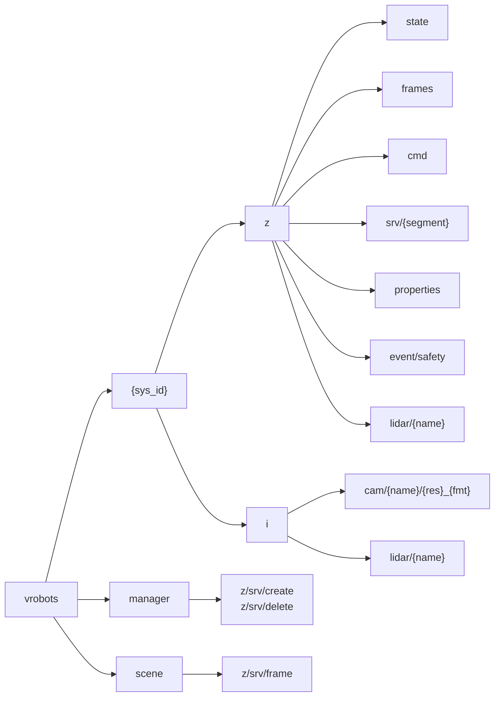

# The topic namespace

Every key the simulator publishes or subscribes, and how a robot's id fits into it.

## One rule generates every name

Every key in the system has the shape `vrobots/<sys_id>/<transport>/<subject...>`.
The segment after the id names the transport: `z` for zenoh, `i` for iceoryx2. Two
reserved words, `manager` and `scene`, sit where a system id would, so a swarm-wide
service can never collide with a robot's own.



Both ends of a wire must agree on these names byte for byte, and a mismatch is
**silent**: a subscriber on a slightly wrong key never fires at all. That is why no
call site in the SDK builds a name inline. Every one of them comes from the
`vrobots_sdk::topics` module, which mirrors the simulator's own table of names, and
it is public so your code can print the same string the simulator uses.

## The full pattern table

| Pattern | Transport | Direction | Contents |
|---|---|---|---|
| `vrobots/{sys_id}/z/state` | zenoh | sim publishes | full state, 25 Hz |
| `vrobots/{sys_id}/z/cmd` | zenoh | sim subscribes | commands; many-to-many, readable by clients |
| `vrobots/{sys_id}/z/srv/{segment}` | zenoh | request/response | per-robot services |
| `vrobots/{sys_id}/z/properties` | zenoh | sim publishes | mass properties and the actuator layout; on open, on change, and at 1 Hz |
| `vrobots/{sys_id}/z/event/safety` | zenoh | sim publishes | safety events; one sample per incident, no fixed rate |
| `vrobots/{sys_id}/z/lidar/{name}` | zenoh | sim publishes | 2-D lidar scans, 10 Hz |
| `vrobots/{sys_id}/i/cam/{name}/{res}_{fmt}` | iceoryx2 | sim publishes | raw camera frames |
| `vrobots/{sys_id}/i/lidar/{name}` | iceoryx2 | sim publishes | 3-D lidar scans, 20 Hz |
| `vrobots/manager/z/srv/create` | zenoh | request/response | spawn a robot |
| `vrobots/manager/z/srv/delete` | zenoh | request/response | remove a robot |
| `vrobots/scene/z/srv/frame` | zenoh | request/response | scene-level coordinate frame |

Two further per-robot zenoh keys exist and are covered where they are used.
`vrobots/{sys_id}/z/frames` publishes the coordinate-frame definitions that result
from a robot's frame configuration, which is a different thing from the `srv/frames`
service that sets them: [Coordinate frames](../ch06-services/04-frames-config.md)
covers both. `vrobots/{sys_id}/z/estimate` carries an external state estimate that
the fixed wing can be told to fly on instead of the truth, described in
[Fixed wing control](../ch04-commands/05-fixed-wing.md).

A concrete camera key, with every placeholder filled in:

```text
vrobots/1/i/cam/front_left/720p_rgba8
```

The `{res}_{fmt}` segment is built from the resolution and pixel format you asked
for, which is why changing a camera's format renames its stream. The full list of
service segments is in [Appendix A: Topic reference](../appendix-a-topics.md); the
ones a given robot answers depend on its type, and asking for one it does not serve
is how a capability probe works.

## Lidar, events and properties

Three topic families sit beside the state stream, and each exists because its data
does not fit a 25 Hz snapshot.

**Lidar** has one topic per unit, named after the unit, and the transport follows the
payload size. A 2-D unit publishes one ring of ranges over zenoh, so it reaches a
program on another machine. A 3-D unit publishes thousands of ranges per scan over
iceoryx2, so it is same-host only, as a camera is. The key has no resolution or
format segment: a lidar has one fixed layout, so its name is the whole identity.

```text
vrobots/0/i/lidar/lidar
vrobots/1/z/lidar/lidar_front_left
```

Those are the Warehouse scene's forklift, which carries one 3-D unit named `lidar`,
and its pallet robot, which carries two 2-D units, `lidar_front_left` and
`lidar_rear_right`. [Lidar](../ch09-lidar/00-intro.md) covers opening a stream and
reading a scan.

> **Gotcha.** Lidar is a Pro feature. On the Community plan no lidar topic exists at
> all, so `vrobots topic list` shows none and an open times out. The SDK cannot tell
> "no such lidar" from "not on this plan": both are a topic that is not there.

**Safety events** are aperiodic. `z/event/safety` carries one sample per incident,
such as a near miss or a contact with a person, and nothing arrives until something
happens. A quiet topic is therefore the normal case rather than a fault, and
`vrobots topic list` shows it only when an event is published while it listens.
[Safety events](../ch10-events/00-safety-events.md) covers the subscriber.

**Properties** describe what the robot is rather than what it is doing: mass, centre
of gravity, inertia, and the kind of device behind each actuator index. The topic
publishes when the robot's ports open, again whenever a parameter changes, and once a
second as a keepalive, so a program that starts late still receives it within a
second. [Robot properties](../ch06-services/13-properties.md) covers reading it, and
[Actuator layouts and typed readers](../ch03-reading-state/10-actuator-layouts.md)
uses it to decode the actuator arrays.

## Service segments by robot type

Every robot answers a common set of eight services, and each robot type adds at most
one of its own. The five below configure the warehouse robots, the arms, the turret
and the lidars; the last of them is one of the common eight.

| Key | Served by | Configures | Page |
|---|---|---|---|
| `vrobots/{sys_id}/z/srv/forklift` | forklift | drive, rear steering, mast | [Forklift and pallet robot configuration](../ch06-services/09-warehouse-config.md) |
| `vrobots/{sys_id}/z/srv/palletrobot` | pallet robot | pulse band, mecanum geometry, drive, pad | [Forklift and pallet robot configuration](../ch06-services/09-warehouse-config.md) |
| `vrobots/{sys_id}/z/srv/arm` | rail arm and table arm | fallback joint speed limits, protective stop, tool | [Arm configuration](../ch06-services/10-arm-config.md) |
| `vrobots/{sys_id}/z/srv/turret` | turret | joint limits and rates, laser range, stereo pair | [Turret configuration](../ch06-services/11-turret-config.md) |
| `vrobots/{sys_id}/z/srv/lidars` | every robot | the mounted lidars, addressed by name | [Lidar configuration](../ch06-services/12-lidar-config.md) |

`srv/arm` is one key for both arms. Each arm applies the tool fields that belong to
it and ignores the other's, so the key alone does not tell you which arm answered.
`srv/lidars` is served by every robot and refuses in its reply on the Community plan,
which makes it one of the two services that ever answer `ok = false`. `srv/skin` is
the other.

## The id slot is the routing

There is no addressing anywhere else in a message. A robot subscribes to its own
`z/cmd` and nothing else, so the id in the key **is** the delivery decision. Send a
command with the wrong id and it is not misrouted to another robot; it is received
by whichever robot owns that key, and the robot you meant hears nothing.

> **Gotcha.** A wrong `sys_id` and a command a robot does not implement look
> identical from outside: the state stream does not change. Confirm the id
> against `vrobots topic list` before suspecting the command.

## Wildcards

Four wildcard keys are worth knowing, all zenoh only.

| Constant | Key | Use |
|---|---|---|
| `topics::ALL` | `vrobots/**` | the discovery subscribe; everything the sim publishes |
| `topics::ALL_STATES` | `vrobots/*/z/state` | one subscriber for every robot's state |
| `topics::ALL_SAFETY_EVENTS` | `vrobots/*/z/event/safety` | one subscriber for every robot's safety events |
| `topics::ALL_LIDARS_2D` | `vrobots/*/z/lidar/*` | every 2-D lidar on every robot |

`ALL_STATES` is the shape a swarm program wants: fifty `VirtualRobot` handles is
fifty sessions and fifty subscriber threads, where one subscription on the wildcard
is one of each. That is a different program from the one this book teaches, and the
key is here so it is buildable.

The last two follow the same shape. `subscribe_all_safety_events()` opens one
subscriber on `ALL_SAFETY_EVENTS` in all three languages. `ALL_LIDARS_2D` matches
every 2-D lidar on every robot, and `vrobots/{sys_id}/z/lidar/*`, which has no
constant, matches every 2-D lidar on one. The 3-D lidars and the cameras are
iceoryx2, which has no wildcard: each stream is opened by its exact name.

Wildcards work for subscribing, not for measuring.
[`measure_rate`](../ch08-tooling/05-rates.md) and `vrobots topic hz` need an exact
key and reject a wildcard with `VrError::InvalidArgument`.

## Reading the namespace back

`vrobots topic list` is the ground truth for what exists right now, and it is the
first command to run when something is not responding. It reports the transport tag,
the measured rate for zenoh topics, and the registry entry for iceoryx2 ones.
[The vrobots command](../ch08-tooling/01-cli.md) documents the flags;
[Discovery from code](../ch08-tooling/02-discovery-from-code.md) does the same
listing from inside a program via `list_topics`.

`topics::sys_id_of(key)` parses the id back out of a key, returning `None` for
`manager` and `scene`. That is the right answer rather than a parse failure: those
two scopes belong to no robot.

**Next:** [System ids, and the two kinds of robot](03-sys-id.md)

**See also:** [Appendix A: Topic reference](../appendix-a-topics.md), [The vrobots command](../ch08-tooling/01-cli.md), [More than one robot](../ch08-tooling/06-multi-robot.md)
