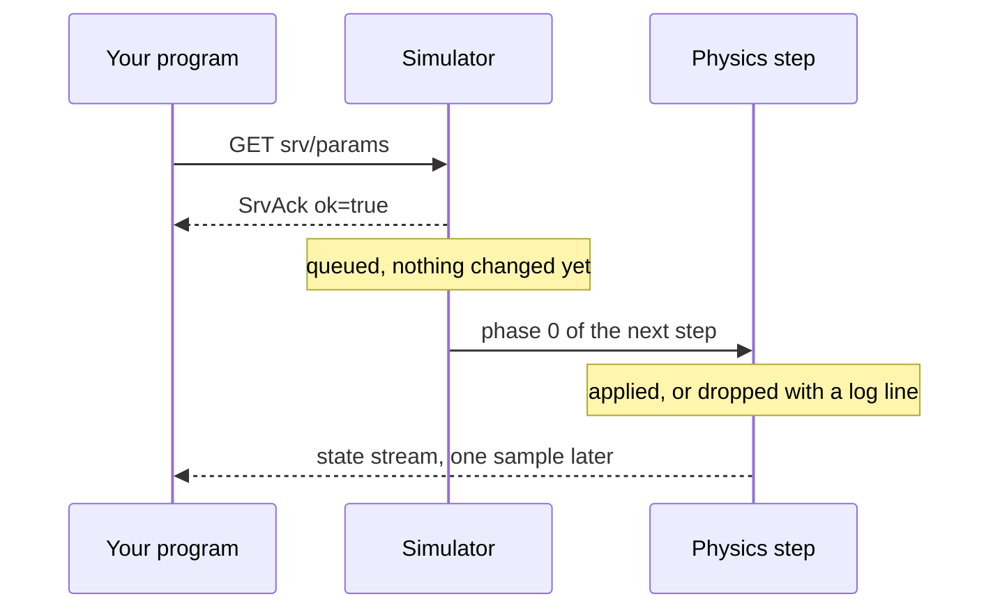

# Services and configuration

One-shot requests that change the robot rather than drive it, and why the reply is not the result.

## What a service is

A service is a zenoh query on `vrobots/{sys_id}/z/srv/{segment}`: you send one request, the
robot sends one reply, and the exchange is over. That is the opposite shape from a command,
which is a publication nobody answers (see
[Commands latch](../ch04-commands/01-latching.md)). Services carry configuration, which is
quasi-static: mass, noise models, rotor geometry, frames, the skin. Commands carry setpoints,
which change every loop iteration.

Two services live outside a robot's namespace. `vrobots/manager/z/srv/delete` belongs to the
scene manager, and `vrobots/scene/z/srv/frame` answers for the scene as a whole. Everything
else is per robot, keyed by [`sys_id`](../appendix-d-glossary.md).

## The ack is a receipt, not a result

Every reply is an `SrvAck`, and the simulator packs it the instant the query lands. The
change itself is applied in [phase 0](../appendix-d-glossary.md) of the robot's **next**
physics step, one step later.



So `Ok(())` means the robot heard you. It does not mean the robot agreed with you.

## Only two services ever say no

`srv/skin` is the single configuration service that can answer `ok = false` about what you
asked for, and it does so only for a tier refusal. `srv/lidars` answers `ok = false` as well,
for one reason only: the plan has no lidar at all (see
[Lidar configuration](12-lidar-config.md)). Everything else acks `ok` whatever you sent. A
rotor list of the wrong length, an unknown frame id, a `drive_mode` that is not 2 or 4, a
noise block for a sensor the robot does not carry: each is acked `ok` and then refused by a
log line inside the simulator that no client can read.

The SDK closes part of that gap by refusing what it can before anything reaches the wire. The
"Refused client-side" column of the table below is the whole of that protection; past it you
are on your own.

> **Gotcha.** A silently dropped request and a successful one are byte-for-byte identical from
> outside the simulator. Detect the difference by measuring the robot, never by reading the
> return value.

## Rules every config service shares

The first and third rules below hold for every service in this chapter. The second is how
the forklift, pallet robot, arm, turret and lidar services treat a bad number. The pages
that follow link here instead of repeating them.

| Rule | What it means for you |
|---|---|
| The ack is a receipt, not an application | `ok` says the robot heard the request. The change lands one physics step later, or is healed, or is dropped, and the ack is the same in all three cases |
| A value that is not finite is refused for that field only | the simulator skips a NaN or an infinite value and applies the rest of the request. The SDK is stricter: it refuses the whole call with `InvalidArgument` before sending, so a bad number never produces a half-applied request |
| No service reads values back | there is no getter for anything you configure. Keep the values you send, confirm them by measuring the robot, and "restore" by sending the shipped value |

An out-of-range value that is finite is a fourth case: the simulator heals it, by clamping
it or by substituting a default, and acks `ok`. The Notes column of each field table says
which. The one thing that is published about a robot's configuration is its mass
properties and actuator layout, on [the properties topic](13-properties.md).

## The state stream is the confirmation

Because of that, the examples in this chapter measure rather than assert. The Rust and C++
`ex27` make the point deliberately by sending a rotor list one entry short, with a thrust curve
that would drop the aircraft out of the sky.


{{#tabs global="lang" }}
{{#tab name="Rust" }}

`examples/rust/src/bin/ex27_rotor_config.rs`:

```rust
    robot.configure_rotors(&short)?;
    println!("... returned Ok. That is a receipt, and the request was dropped:");
    let dropped = climb(&robot, "after the short list", &collective)?;
```

{{#endtab }}
{{#tab name="C++" }}

`examples/cpp/ex27_rotor_config.cpp`:

```cpp
robot.configure_rotors(shortlist);
std::printf("... returned without throwing. That is a receipt, and the request was "
            "dropped:\n");
const Run dropped = climb(robot, "after the short list", collective);
```

{{#endtab }}
{{#tab name="Python" }}

`examples/python/ex27_rotor_config.py` leaves the short list out and sends only full-length
lists. A short list passed to `configure_rotors` from Python returns just as quietly, because
the call goes through the same SDK core and the same wire.

{{#endtab }}
{{#endtabs }}

Rust and C++ report failure differently, and that is exactly what makes the point here: the
Rust `?` and the C++ `catch` both stay quiet, because a dropped request is acked `ok` on the
wire and neither has anything to raise.

The `?` never fires, and the aircraft climbs exactly as it did before, which is the proof that
nothing was applied:

```text
configure_rotors with <n-1> entries for <n> rotors ...
... returned Ok. That is a receipt, and the request was dropped:
-- after the short list --
   t=<seconds>s alt=<metres> m  climb=<rate> m/s  measured=[...]
```

## The service map

Every live robot serves the same eight keys, whatever its type:

| Segment | Method | Page |
|---|---|---|
| `activate` | `activate`, and inside `connect` for a robot it creates | [Robot lifecycle](01-lifecycle.md) |
| `reset` | `reset` | [Robot lifecycle](01-lifecycle.md) |
| `params` | `set_physical_params` | [Mass and inertia](02-physical-params.md) |
| `sensors` | `configure_sensors` | [Sensor noise](03-sensor-config.md) |
| `frames` | `set_frames` | [Coordinate frames](04-frames-config.md) |
| `cameras` | `mount_camera`, `unmount_camera` | [Mount, open and unmount](../ch05-cameras/01-mount-open-unmount.md) |
| `skin` | `set_skin` | [Skins](08-skins.md) |
| `lidars` | `configure_lidars` | [Lidar configuration](12-lidar-config.md) |

`lidars` re-mounts and retunes the lidars a robot already carries. Every robot answers it,
but it needs the Pro plan and does nothing on a robot with no lidar.

One more service belongs to each of these robot types, and to nothing else:

| Segment | Method | Robot | Page |
|---|---|---|---|
| `drive` | `configure_drive` | Truck | [The truck drivetrain](05-drive-config.md) |
| `rotors` | `configure_rotors` | Multirotor | [Rotors and thrust curves](06-rotor-config.md) |
| `msd` | `configure_msd` | Msd | [Mass spring damper and cart pole](07-msd-cartpole-config.md) |
| `cartpole` | `configure_cartpole` | CartPole | [Mass spring damper and cart pole](07-msd-cartpole-config.md) |
| `forklift` | `configure_forklift` | Forklift | [Forklift and pallet robot configuration](09-warehouse-config.md) |
| `palletrobot` | `configure_palletrobot` | PalletRobot | [Forklift and pallet robot configuration](09-warehouse-config.md) |
| `arm` | `configure_arm` | RailArm and TableArm, one service for both | [Arm configuration](10-arm-config.md) |
| `turret` | `configure_turret` | Turret | [Turret configuration](11-turret-config.md) |

HalfDrone and GlobalHawk add nothing: their entire control surface is command-level.

One thing in this chapter is a topic and not a service. Each robot publishes its mass
properties and its actuator layout on `z/properties`, and `properties()` reads one sample:
[Robot properties](13-properties.md).

Signatures, with what each refuses before publishing:

| Method | Signature | Topic | Refused client-side | Robot |
|---|---|---|---|---|
| `reset` | `() -> VrResult<()>` | `srv/reset` | nothing | all |
| `set_physical_params` | `(&PhysicalParams) -> VrResult<()>` | `srv/params` | empty request, mass not positive-finite, any MOI axis not positive-finite | all |
| `set_skin` | `(&str) -> VrResult<()>` | `srv/skin` | an empty name | all |
| `configure_sensors` | `(&SensorConfig) -> VrResult<()>` | `srv/sensors` | empty request, any non-finite value | all |
| `set_frames` | `(Option<&str>, &[DeviceFrame]) -> VrResult<()>` | `srv/frames` | both halves empty, an entry with an empty device or frame id | all |
| `scene_frame` | `() -> VrResult<SceneFrame>` | `vrobots/scene/z/srv/frame` | nothing | scene scope |
| `configure_drive` | `(&DriveConfig) -> VrResult<()>` | `srv/drive` | empty request, `drive_mode` not 2 or 4, any non-finite value | Truck |
| `configure_rotors` | `(&[RotorSpec]) -> VrResult<()>` | `srv/rotors` | an empty slice, any non-finite value | Multirotor |
| `configure_msd` | `(&MsdConfig) -> VrResult<()>` | `srv/msd` | empty request, a negative or non-finite value | Msd |
| `configure_cartpole` | `(&CartPoleConfig) -> VrResult<()>` | `srv/cartpole` | empty request, a non-positive mass, length or force, any non-finite value | CartPole |
| `delete` | `() -> VrResult<()>` | `manager/z/srv/delete` | already deleted | all |
| `is_deleted` | `() -> bool` | local flag | | all |

The services of the warehouse robots, the arms, the turret and the lidars take their fields
by name, and their signatures are on their own pages:

| Method | Topic | Refused client-side | Robot |
|---|---|---|---|
| `configure_forklift` | `srv/forklift` | empty request, any non-finite value | Forklift |
| `configure_palletrobot` | `srv/palletrobot` | empty request, any non-finite value | PalletRobot |
| `configure_arm` | `srv/arm` | empty request, any non-finite value, speed fallbacks that are not one per joint | RailArm, TableArm |
| `configure_turret` | `srv/turret` | empty request, any non-finite value, a non-positive rate, baseline, focal length or laser range, a minimum above its maximum | Turret |
| `configure_lidars` | `srv/lidars` | no entries, a bad or repeated name, an entry that sets nothing, a non-finite mount | all |

## Asking for a service the robot does not serve

A robot registers a queryable only for its own type's service, so `configure_drive` on a
multirotor is a query nobody answers. After `ConnectOptions::service_timeout` (8 seconds by
default) it returns [`VrError::NoResponder`](../appendix-c-errors.md).

That is not a failure mode to defend against, it is a capability probe: it is how the Rust
and C++ versions of `ex30_hello_halfdrone` establish that a HalfDrone serves the common
services and nothing more.
It is also indistinguishable from a simulator that is not running, so confirm with
`vrobots topic list` before drawing a conclusion.

A cheaper way to learn what a robot is, without waiting out a timeout, is to read its
actuator layout from [the properties topic](13-properties.md#the-layout-is-the-type-check).

**Next:** [Robot lifecycle](01-lifecycle.md)

**See also:** [Five rules that explain everything](../ch02-concepts/06-five-rules.md), [The topic namespace](../ch02-concepts/02-topics.md), [Appendix C: Error reference](../appendix-c-errors.md)
