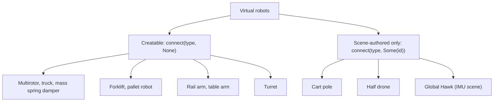

# Supported virtual robots

The roster: which robots exist, which you can create, and what each one accepts.

Eleven robot types are reachable from the SDK. Eight of them you can ask the simulator to
spawn; three exist only where a scene author placed them, and you attach to those by
`sys_id`. This page is the index. The robot pages after it use one fixed template, so you
can compare any two robots section by section.

## The roster

| Robot | `RobotType` | Catalog key | Creatable | Drive command | Type-specific service |
|---|---|---|---|---|---|
| [Multirotor](01-multirotor.md) | `Multirotor` | `multirotor` | yes | `SET_MR_PWM` | `srv/rotors` |
| [Truck](02-truck.md) | `Truck` | `truck` | yes | `SET_CAR` | `srv/drive` |
| [Mass spring damper](03-msd.md) | `Msd` | `msd` | yes | `SET_MSD` | `srv/msd` |
| [Cart pole](04-cartpole.md) | `CartPole` | `cartpole` | no, scene-authored | `SET_INVPEN` | `srv/cartpole` |
| [Half drone](05-halfdrone.md) | `HalfDrone` | `halfdrone` | no, scene-authored | `SET_MR_PWM`, exactly two values | none |
| [Global Hawk](06-globalhawk.md) | `GlobalHawk` | `globalhawk` | no, scene-authored | `SET_ANGVEL` tracking, or direct surfaces | none |
| [Forklift](08-forklift.md) | `Forklift` | `forklift` | yes | `SET_FORKLIFT` | `srv/forklift` |
| [Pallet robot](09-palletrobot.md) | `PalletRobot` | `palletrobot` | yes | `SET_PALLETROBOT` | `srv/palletrobot` |
| [Rail arm](10-rail-arm.md) | `RailArm` | `kr210_rail` | yes | `SET_ARM_JOINTS`, `SET_ARM_VACUUM` | `srv/arm` |
| [Table arm](11-table-arm.md) | `TableArm` | `tablearm` | yes | `SET_ARM_JOINTS`, `SET_ARM_GRIPPER` | `srv/arm` |
| [Turret](12-turret.md) | `Turret` | `turret` | yes | `SET_TURRET_RATES`, `SET_TURRET_JOINTS`, `SET_TURRET_LASER` | `srv/turret` |

`RobotType::from_catalog_key` is case-insensitive and accepts synonyms: `car` for the
truck, `cart_pole` and `invpen` for the cart pole, `mass_spring_damper` for the mass spring
damper, `half_drone` for the half drone, `global_hawk` and `rq4b` for the Global Hawk,
`pallet_robot` for the pallet robot, `railarm`, `rail_arm` and `kuka_kr210_rail` for the
rail arm, and `table_arm` for the table arm. Only `catalog_key()` ever reaches the wire,
where the simulator matches it exactly and case-sensitively.

## Where each robot lives

| Scene | Robots it ships | `sys_id` |
|---|---|---|
| Sandbox | multirotor, truck, cart pole, turret | allocated at scene load |
| Flatworld | truck, multirotor | allocated at scene load; 0 and 1 on a fresh boot |
| IMU | Global Hawk | allocated at scene load |
| Warehouse | forklift, pallet robot, rail arm | **pinned**: 0, 1, 2 |
| Table Arm (Pro plan) | table arm | **pinned**: 0 |

A pinned id is the same on every load, so the examples for those robots default to it. Every
other id is allocated at scene load and keeps incrementing across loads, so no constant in
an example is a contract. Read the live ids with `vrobots topic list`.

```sh
vrobots topic list
```

## Creatable and scene-authored

The create catalog registers eight keys: `multirotor`, `truck`, `msd`, `forklift`,
`palletrobot`, `kr210_rail`, `tablearm` and `turret`. Asking `srv/create` for anything else
is refused with a message naming the keys the scene does know, which is also the only live
way to enumerate a catalog. Creating a robot at all needs the Pro plan.



A creatable robot can also be attached to: `connect(RobotType::Multirotor, Some(1))` never
touches `srv/create` and works for any robot the scene contains, whatever the catalog says.
The arrow runs one way only, so a scene-authored type has exactly one route in.

> **Gotcha.** A created robot appears at the scene origin, unrotated, unless you give it a
> spawn pose, and that pose is in raw Unity world coordinates, not in your header frame. Two
> robots created without one overlap. [Known simulator issues](07-known-issues.md) has the
> detail, including what is different about a created table arm.

## What every live robot serves

Eight services are common to every robot that is publishing, on
`vrobots/{sys_id}/z/srv/{segment}`:

| Segment | SDK method | What it does |
|---|---|---|
| `activate` | `activate()`, and part of `connect` for a created robot | releases a dormant robot's dynamics hold |
| `reset` | `reset()` | teleports home, zeroes velocity, re-latches the initial command |
| `params` | `set_physical_params` | mass and principal moments of inertia |
| `skin` | `set_skin` | appearance, from a per-type catalog |
| `cameras` | `mount_camera`, `unmount_camera` | camera upsert and remove |
| `sensors` | `configure_sensors` | the sensor noise model |
| `frames` | `set_frames` | robot-level and device-level coordinate frames |
| `lidars` | `configure_lidars` | re-mounts and retunes the lidars a robot already carries |

`srv/lidars` is refused outside the Pro plan and does nothing on a robot with no lidar; see
[Lidar configuration](../ch06-services/12-lidar-config.md). The robot pages call this set
"the common eight".

Each robot type then adds at most one service of its own, as tabulated above. Asking a
robot for a service its type does not serve returns `VrError::NoResponder` after the
service timeout.

Nothing in a state message names the robot's type. The topic that does is
`vrobots/{sys_id}/z/properties`, read with `properties()` on a handle or with
`read_properties(sys_id)` and no handle: it carries the mass properties
and the kind of every actuator entry, which is how you tell a rail arm from a table arm or
find the turret among three-entry robots. See
[Robot properties](../ch06-services/13-properties.md).

> **Gotcha.** `srv/reset` and `srv/activate` are the two service keys where a payload-less
> GET performs the action instead of probing it. A bare GET on `srv/reset` resets the robot,
> and one on `srv/activate` releases a dormant robot's dynamics; a second one does nothing,
> so it is harmless on a robot already running. Probe any other key freely.

## How to read the robot pages

Every robot page carries the same seven sections in the same order: Identity, Physical
model, Commands accepted, Services, Hardware, Known quirks, Example. A section with nothing
to report says so and does not disappear, so a blank is a fact and not an omission.

Hardware is the same on every page too: the drawings, then Actuators, Sensors, Cameras,
Lidars, and Body and frame. The drawings are the simulator's own layout sheets, to scale,
with every position measured from the robot origin; the tables beside them give the same
mounts in the frame the robot reports in. Five robots have no layout sheet. The mass spring
damper, the cart pole, the half drone and the Global Hawk carry tables only, and the rail
arm has a block schematic that shows order and limits and no geometry.

A few defaults are still missing, mostly moments of inertia and overall dimensions. Each is
marked where it would have gone, and `properties()` reads the mass properties off any live
robot.

**Next:** [Multirotor](01-multirotor.md)

**See also:** [System ids, and the two kinds of robot](../ch02-concepts/03-sys-id.md), [Sending commands](../ch04-commands/00-intro.md), [Services and configuration](../ch06-services/00-intro.md), [Known simulator issues](07-known-issues.md)
