# Table arm

A six-axis tabletop arm with a two-finger gripper commanded in metres, and two cameras over a sorting cell.

## Identity

| Property | Value |
|---|---|
| `RobotType` | `TableArm` |
| Catalog key | `tablearm` |
| Synonyms | `table_arm` |
| Creatable | yes, on the Pro plan; see the spawn caveats below |
| Scene-authored | yes, the Table Arm scene ships one, pinned at `sys_id` 0 |
| Wire name | `tablearm` |
| Default frame | `fru` |
| Type-specific service | `srv/arm`, shared with the [rail arm](10-rail-arm.md) |

The Table Arm scene pins its arm at `sys_id` 0, so attach with
`connect(RobotType::TableArm, Some(0))`. The scene itself needs the Pro plan.

## Physical model

A UR10 with a Robotiq 2F-85 gripper, at the back of a tabletop sorting cell. Like the rail
arm it is **kinematic**: six position servos, A1 to A6 (base, shoulder, elbow and three
wrists), each moving toward its setpoint at its own top speed with no acceleration ramp.

The range and speed limit of every joint are in the actuator table under
[Hardware](#hardware).

Home is the pose the arm loads in, and nothing on the wire publishes it. Read the joints
once after connecting to learn it. The base never moves, and the state's kinematics are the
base's.

**Protective stop.** Every joint step is tested against the scene before it is taken, as on
the rail arm, and this arm also refuses to drive into **itself**. Neighbouring links are
exempt, so a folding elbow stops when the forearm, wrist or gripper meets the shoulder, the
upper arm or the base.

**Gripper.** The command is the gap between the pads, 0 to 0.085 m. The fingers close at
0.15 m/s of opening, the whole stroke in under 0.6 s, and each finger step is tested against
the scene too: that stop is how the gripper feels an object. An object is **held** when both
pads press it from the inside, it is a loose object, and it weighs no more than the payload,
5 kg by default. It then rides with the gripper until the commanded opening is at least 2 mm
wider than it. Grip force, slip and crushing are not simulated: held is held.

## Commands accepted

| Command | Method | Units and range | Status |
|---|---|---|---|
| `SET_ARM_JOINTS` (315) | `set_arm_joints(setpoints)` | 6 values, A1 to A6 in rad | live |
| `SET_ARM_GRIPPER` (320) | `set_arm_gripper(opening_m)` | m, clamped to 0 to 0.085 | live |

Both latch, and the joint command follows the rail arm's rules: clamped per joint, refused
whole by the SDK on a wrong count or a non-finite entry. `SET_ARM_VACUUM` belongs to the
rail arm and is ignored here.

The `gripper` helper commands an opening and waits until the pads arrive or close on
something:

{{#tabs global="lang" }}
{{#tab name="Rust" }}

`examples/rust/src/bin/ex40_table_arm.rs`:

```rust
fn gripper(robot: &VirtualRobot, opening_m: f64) -> Result<(), VrError> {
    println!("\n-- gripper to {:.1} mm --", opening_m * 1e3);
    let t0 = robot.states().elapsed;
    for _ in 0..GRIP_SAMPLES {
        robot.set_arm_gripper(opening_m)?;
        robot.rate(HZ);
        let arm = robot.table_arm_actuators()?;
        if arm.holding || (arm.gripper_opening_m - opening_m).abs() < GRIP_TOLERANCE_M {
            println!("   t={:5.2}s  {}", robot.states().elapsed - t0, tool(&arm));
            return Ok(());
        }
    }
    // Stopped short with nothing held: something is between the pads that the
    // gripper will not hold -- fixed scenery, or over the payload.
    println!(
        "   stopped short, holding nothing: {}",
        tool(&robot.table_arm_actuators()?)
    );
    Ok(())
}
```

{{#endtab }}
{{#tab name="C++" }}

`examples/cpp/ex40_table_arm.cpp`:

```cpp
void gripper(vrsdk::VirtualRobot& robot, double opening_m) {
    std::printf("\n-- gripper to %.1f mm --\n", opening_m * 1e3);
    const double t0 = robot.states().elapsed;
    for (int i = 0; i < GRIP_SAMPLES; ++i) {
        robot.set_arm_gripper(opening_m);
        robot.rate(HZ);
        const vrsdk::TableArmActuators arm = robot.table_arm_actuators();
        if (arm.holding || std::fabs(arm.gripper_opening_m - opening_m) < GRIP_TOLERANCE_M) {
            std::printf("   t=%5.2fs  %s\n", robot.states().elapsed - t0, tool(arm).c_str());
            return;
        }
    }
    // Stopped short with nothing held: something is between the pads that the
    // gripper will not hold -- fixed scenery, or over the payload.
    std::printf("   stopped short, holding nothing: %s\n",
                tool(robot.table_arm_actuators()).c_str());
}
```

{{#endtab }}
{{#tab name="Python" }}

`examples/python/ex40_table_arm.py`:

```python
def gripper(robot, opening_m):
    """Command an opening, metres, and read GRIPPER, HOLD and CONTACT once the pads
    have arrived -- or once they have closed on something.
    """
    print(f"\n-- gripper to {opening_m * 1e3:.1f} mm --")
    t0 = robot.states.elapsed
    for _ in range(GRIP_SAMPLES):
        robot.set_arm_gripper(opening_m)
        robot.rate(HZ)
        arm = robot.table_arm_actuators()
        if arm.holding or abs(arm.gripper_opening_m - opening_m) < GRIP_TOLERANCE_M:
            print(f"   t={robot.states.elapsed - t0:5.2f}s  {tool(arm)}")
            return
    # Stopped short with nothing held: something is between the pads that the
    # gripper will not hold -- fixed scenery, or over the payload.
    print(f"   stopped short, holding nothing: {tool(robot.table_arm_actuators())}")
```

{{#endtab }}
{{#endtabs }}

Closed on thin air to 40 mm, the pads arrive and nothing is held:

```text
-- gripper to 40.0 mm --
   t= 0.33s  GRIPPER [6]: latch 40.0 mm, pads 40.0 mm apart   HOLD [8]: holding=false, 0.00 kg   CONTACT [7]: no_contact (code 0)
```

Python prints `holding=False`.

## Services

The common eight plus `srv/arm`, called through `configure_arm`. The shared fields are the
rail arm's, with one different default: `self_collision` is **on** here. The fields that
differ on this arm:

| Field | Units | Default | Notes |
|---|---|---|---|
| `fallback_speed_limits` | 6 values, rad/s | 120 / 120 / 180 / 180 / 180 / 180 deg/s | all or nothing; **changes no speed on this arm** |
| `self_collision` | bool | on | acts only with the protective stop on |
| `gripper_speed` | m/s of opening | 0.15 | 0 or less reverts to the default; clamped to 0.02 to 0.15 |
| `gripper_max_payload` | kg | 5 | applies from the next grasp; 0 or less reverts to the default |
| `suction_capacity`, `suction_reach`, `suction_max_tilt`, `suction_accel_window` | | | ignored: this arm has no vacuum |

`protective_stop`, `contact_tolerance`, `strike_speed` and `collision_rearm` are tabulated on
the [rail arm](10-rail-arm.md) page. No field can be read back, and the finger stop runs
even with `protective_stop` off.

`reset()` lets go of a held object where it is, at rest, opens the gripper at once, clears
CONTACT and teleports every joint home with its setpoint. In the Table Arm scene the cell
also puts its objects back. The full field reference is on
[The arms](../ch06-services/10-arm-config.md).

## Hardware

The drawings are to scale, on a 0.1 m grid with a heavier line every 0.5 m, and show the arm
in the sorting cell of the Table Arm scene. The board, the bins and the objects belong to
that scene; a table arm you create is the arm and gripper only. Distances on the drawings
are measured on the board. The robot origin is at the centre of the arm base, 0.03 m above
the board top, and in the robot's `fru` frame the cell lies **behind** the arm: +x points
from the board centre toward the arm and beyond, and +y to the right of the top view.

[](images/table-arm-cell-top.svg)

*Top view, the arm at the back of the board. The dashed blue rectangle is what the `table`
camera sees in the 360p stream it ships with; the solid blue rectangle is the 4:3 footprint
of the cell's design and is not a stream. The orange circles are 1.0 m and 1.3 m around the
base axis, the second being the arm's reach. Pink is an example `wrist` camera footprint
with the flange 0.30 m above the centre of the camera zone, and the hatched part is hidden
behind the gripper. The orange strip on each bin is its low wall.*

[](images/table-arm-cell-side.svg)

*Side view through the middle of the board, front to the left and the arm on the right.
The `table` camera sits 1.70 m over the board centre, which is 1.67 m above the robot
origin and 0.45 m behind it; its 50 degree vertical view meets the board 0.793 m either
side of centre, outside the board's 0.70 m half depth. The arm is a schematic drawn with
the real link lengths, tool down, flange 0.30 m up. Pink is the `wrist` camera's 70 degree
view, 0.06 m off the tool axis, and grey is the part the gripper hides.*

### Actuators

Nine entries, like the rail arm's, and laid out differently after the joints. `pwm` is 0
throughout.

| # | Device | Kind | Driven by | `normalized` | `measured` | Range | Speed limit |
|---|---|---|---|---|---|---|---|
| 0 | A1, base, revolute | `SERVO` | entry 0 of `SET_ARM_JOINTS`, rad | position across its range, [-1, 1] | rad | -360 to 360 degrees | 120 deg/s |
| 1 | A2, shoulder, revolute | `SERVO` | entry 1, rad | position across its range, [-1, 1] | rad | -360 to 360 degrees | 120 deg/s |
| 2 | A3, elbow, revolute | `SERVO` | entry 2, rad | position across its range, [-1, 1] | rad | -360 to 360 degrees | 180 deg/s |
| 3 | A4, wrist, revolute | `SERVO` | entry 3, rad | position across its range, [-1, 1] | rad | -360 to 360 degrees | 180 deg/s |
| 4 | A5, wrist, revolute | `SERVO` | entry 4, rad | position across its range, [-1, 1] | rad | -360 to 360 degrees | 180 deg/s |
| 5 | A6, wrist, revolute | `SERVO` | entry 5, rad | position across its range, [-1, 1] | rad | -360 to 360 degrees | 180 deg/s |
| 6 | GRIPPER, two fingers | `GRIPPER` | `SET_ARM_GRIPPER`, m | commanded opening over 0.085, [0, 1] | gap between the pads now, m; the object's width while holding | 0 to 0.085 m, an 85 mm stroke | 0.15 m/s of opening, settable from 0.02 to 0.15 |
| 7 | CONTACT | `CONTACT` | nothing: it is a reading | 0 | 0 none, 1 tool contact, 2 collision stop | | |
| 8 | HOLD | `HOLD` | nothing: it is a reading | 1 holding, 0 not | held mass, kg; 0 is nothing held | payload up to 5 kg | |

No joint has an acceleration ramp, so a 90 degree step of A3 takes about 0.52 s.
`table_arm_actuators()` decodes the report into `joints`,
`joints_normalized`, `gripper_command_m`, `gripper_opening_m`, `holding`, `held_mass_kg` and
`contact`. Decode by robot type and never by count: read as a rail arm's, these nine entries
decode without complaint into wrong numbers. See
[Actuator layouts and typed readers](../ch03-reading-state/10-actuator-layouts.md).

CONTACT speaks only for joint steps. A finger stopping on an object is not a contact and
changes nothing there. A collision stop against the scene publishes one safety event per
episode; a stop against the arm itself publishes none. See
[Safety events](../ch10-events/00-safety-events.md).

### Sensors

The standard five are fitted, at the origin of the base. The base is fixed, so they publish
constants plus their noise: nothing here measures the joints.

| Sensor | Measures | Units | Rate | Mount | Frame | What to know |
|---|---|---|---|---|---|---|
| Accelerometer | specific force on the body axes | m/s² | every state sample | robot origin, no offset, no rotation | the robot's, `fru` | +1 g at rest and 0 in free fall; clips without warning at ±2 g (19.61 m/s²); resolution about 0.0006 m/s²; white noise, a turn-on bias and a slowly drifting bias |
| Gyroscope | body rates | rad/s | every state sample | robot origin, no offset, no rotation | the robot's, `fru` | clips at ±250 deg/s (4.36 rad/s); resolution about 0.00013 rad/s; a turn-on bias of about 0.3 deg/s, one sigma, plus drift |
| Magnetometer | ambient magnetic field on the body axes | gauss | every state sample | robot origin, no offset, no rotation | the robot's, `fru` | clips at ±49.1 G; resolution 0.0015 G; a fixed turn-on offset of about 0.05 G, one sigma |
| Barometer | static pressure, and the pressure altitude computed from it | Pa, m | every state sample | robot origin | none: the readings are scalars | pressure noise of 3 Pa, about 0.25 m near sea level; the altitude is computed from the noisy pressure |
| GNSS | geodetic position and velocity | deg, deg, m and m/s | every state sample | robot origin, no antenna offset | geographic in every frame: latitude, longitude, altitude, and velocity as north, east, down | position noise of 1.5 m horizontal and 3.0 m vertical, velocity noise of 0.05 m/s horizontal and 0.08 m/s vertical, one sigma |
| Optical flow | horizontal ground velocity on the body axes | m/s | every state sample, once fitted | robot origin | the robot's, `fru` | **not fitted by default**; fit it through sensor config; noise of 0.05 m/s per axis |

The noise figures are the simulator's defaults, and every one of them is settable: see
[Sensor noise](../ch06-services/03-sensor-config.md). The fields each device publishes are on
[Sensors](../ch03-reading-state/03-sensors.md). A device keeps the robot's frame unless you
give it one of its own through [Coordinate frames](../ch06-services/04-frames-config.md).
<!-- VERIFY: GNSS update rate. The Sensors page describes a receiver at about 5 Hz; the simulator's notes describe a fresh fix on every physics step. -->

### Cameras

Two cameras, both **360p**, so this robot's defaults are not the `front_left` and
`front_right` pair at 720p that most robots carry.

| Name | Mount in `fru`, m | Orientation | Stream | Focal lengths | Field of view | Clip | Rate | Plan |
|---|---|---|---|---|---|---|---|---|
| `table` | (-0.45, 0, 1.67), fixed: 1.70 m above the centre of the board | straight down at the cell; the arm side of the board is at the top of the picture | 360p rgba8, 640 by 360 | fx 386.0 px, fy 386.0 px | 79.3 by 50 degrees | 0.05 to 5 m | every rendered frame, about 60 per second | Community and Pro |
| `wrist` | on the flange, 0.06 m off the tool axis, moving with the tool | along the tool axis, between the fingers | 360p rgba8, 640 by 360 | fx 257.1 px, fy 257.1 px | 102.4 by 70 degrees | 0.01 to 5 m | every rendered frame, about 60 per second | Pro |

At 360p one `table` pixel covers about 4.4 mm of the board. Open one with
`open_camera("table", "360p", "rgba8")`. On the Community plan only `table` streams. Each
frame carries the mount pose it was rendered with, so a `wrist` frame never has to be
matched to a joint sample. See [Cameras and images](../ch05-cameras/00-intro.md).

### Lidars

None.

### Body and frame

| Property | Value |
|---|---|
| Arm | a UR10 with a Robotiq 2F-85 gripper |
| Mass on the properties topic | 33.6 kg: every body of the arm, gripper included. The maker's figures are 28.9 kg for the arm and 0.9 kg for the gripper; the simulator's link masses come from the public UR10 robot model, which sums higher |
| Centre of gravity | follows the pose |
| Inertia | not published; see [Robot properties](../ch06-services/13-properties.md#arms-publish-the-whole-rig-and-no-inertia) |
| Reach | 1.3 m from the base axis |
| Robot origin | the centre of the arm base, which never moves; in the Table Arm scene it is 0.03 m above the board top and 0.45 m behind the board centre |
| Board, in the Table Arm scene | 1.60 by 1.40 m, 0.04 m thick |
| Default frame | `fru`: x forward, y right, z up |

Everything is SI: radians on the axes and **metres** on the gripper. Joint values carry no
axes, so nothing is frame-converted. The base publishes `fru`, with the `axis_convention`
tag unspecified because `fru` has no `Axes` constant.

## Known quirks

> **Gotcha.** The gripper is in metres and the clamp is silent. A millimetre figure such as
> `40.0` is clamped to 0.085 and opens the gripper fully, with nothing refused. Detect it by
> reading `gripper_command_m` back: it reports 0.085, not what you sent.

A created table arm differs from the scene's in two ways, both covered on
[Known simulator issues](07-known-issues.md): it starts in the all-zero pose, because the
cell's home pose belongs to the Table Arm scene, and it should be created with the name
`tablearm`, because a robot created without a name is called `tablearm_<sys_id>` on the wire.
A created arm is the arm and gripper only: the board, the bins and the scoring belong to the
scene.

Three more:

- The pads swing on an arc, so they also travel along the tool axis while closing. Keep the
  fingertips clear of the table in a grip pose.
- A cone 10 mm off-centre is not grasped: the pad presses its slope down and floor friction
  pins it. A sphere or a cube slides over and is held.
- An object under or beside a single pad is never held. Both pads have to press it.

## Example

ex40 turns A1 and A6, closes the gripper to 40 mm and opens it again, and returns the joints
to where it found them:

```sh
cargo run -p vrobots-examples --bin ex40_table_arm
./target/cpp-build/ex40_table_arm
python examples/python/ex40_table_arm.py
```

It takes an optional `sys_id` and defaults to 0, the Table Arm scene's arm. An arm found
holding something is left alone, because opening would drop it. The example never deletes
the arm.

**Next:** [Turret](12-turret.md)

**See also:** [Moving the arms](../ch04-commands/13-arms.md), [The arms](../ch06-services/10-arm-config.md), [Rail arm](10-rail-arm.md), [Safety events](../ch10-events/00-safety-events.md)
