# Turret

A fixed pan-tilt turret with a laser along its barrel and a stereo camera pair on its head.

## Identity

| Property | Value |
|---|---|
| `RobotType` | `Turret` |
| Catalog key | `turret` |
| Synonyms | none |
| Creatable | yes, on the Pro plan |
| Scene-authored | yes, the sandbox scene ships one; its `sys_id` is **not pinned** |
| Wire name | `turret` |
| Default frame | `cv` |
| Type-specific service | `srv/turret` |

The sandbox turret gets whatever id the scene load hands it, so discover it. `vrobots topic
list` shows the robots, and `read_properties(sys_id)` tells you which one is the turret
without connecting to any of them: it is the robot whose actuator layout equals
`turret_actuator::KINDS`, which is `[SERVO, SERVO, LASER]`. The entry count alone does not
identify it, because a cart pole reports three entries too. Then attach with
`connect(RobotType::Turret, Some(sys_id))`.
[Robot properties](../ch06-services/13-properties.md#reading-by-sys-id-with-no-handle)
shows the search. A turret you create without a name is called after its catalog key and
its id, `turret_15` for instance.

## Physical model

A robot that never travels. A pylon turns on a base that rests on the floor, and a head
tilts on the pylon; the barrel, the laser and both cameras ride the head. The body weighs
500 kg and gravity alone seats it.

| Joint | Positive | Default limits | Default max rate |
|---|---|---|---|
| heading, the pylon | turns **right**, seen from above | -90 to +90 degrees | 90 deg/s |
| pitch, the head | raises the barrel | -15 to +67.5 degrees | 60 deg/s |

Both axes pass through one point, the pivot, so aiming is a pure pan and tilt about it. In
the robot's `cv` frame (x right, y down, z forward), measured from the robot origin at the
centre of the base, with the turret at rest:

| Point | x, y, z in m |
|---|---|
| pivot | (-0.0009, -2.1070, 0) |
| muzzle | (-0.0009, -2.1670, 1.8125) |
| left camera centre | (-0.401, -2.457, 0.400) |
| right camera centre | (+0.399, -2.457, 0.400) |

The muzzle is 0.06 m above the pivot and 1.8125 m ahead of it along the barrel. There is no
acceleration limit: a rate applies at once.

The laser is a range measurement. While it is on, the simulator measures the distance from
the muzzle to the first thing the beam hits, every physics step, ignoring the turret's own
body, up to a maximum range of 200 m by default.

## Commands accepted

| Command | Method | Units and range | Status |
|---|---|---|---|
| `SET_TURRET_RATES` (317) | `set_turret_rates(heading_rate, pitch_rate)` | rad/s, clamped to each joint's max rate | live |
| `SET_TURRET_JOINTS` (318) | `set_turret_joints(heading, pitch)` | rad, clamped to each joint's limits | live |
| `SET_TURRET_LASER` (319) | `set_turret_laser(on)` | on or off | live |

All three latch. The two motion commands **share one latch**, so whichever arrived last is
in charge: a rate turns the joint until it reaches a limit, and a target is reached at the
max rate and then held. The laser has a latch of its own. Joint angles carry no axes, so
nothing is frame-converted, and the SDK refuses a non-finite value before publishing.

The rate phase of ex41 turns the pylon and then stops it explicitly:

{{#tabs global="lang" }}
{{#tab name="Rust" }}

`examples/rust/src/bin/ex41_hello_turret.rs`:

```rust
// ===== a rate: SET_TURRET_RATES =====
println!(
    "\n-- heading rate {RATE} rad/s for {:.1} s --",
    f64::from(RATE_SAMPLES) / HZ
);
for i in 0..RATE_SAMPLES {
    robot.set_turret_rates(RATE, 0.0)?;
    robot.rate(HZ);
    if i % 10 == 9 {
        println!("   {}", report(&robot.turret_actuators()?));
    }
}
// A rate latches: without this the pylon would keep turning to its limit.
robot.set_turret_rates(0.0, 0.0)?;
```

{{#endtab }}
{{#tab name="C++" }}

`examples/cpp/ex41_hello_turret.cpp`:

```cpp
// ===== a rate: SET_TURRET_RATES =====
std::printf("\n-- heading rate %g rad/s for %.1f s --\n", RATE, RATE_SAMPLES / HZ);
for (int i = 0; i < RATE_SAMPLES; ++i) {
    robot.set_turret_rates(RATE, 0.0);
    robot.rate(HZ);
    if (i % 10 == 9) {
        std::printf("   %s\n", report(robot.turret_actuators()).c_str());
    }
}
// A rate latches: without this the pylon would keep turning to its limit.
robot.set_turret_rates(0.0, 0.0);
```

{{#endtab }}
{{#tab name="Python" }}

`examples/python/ex41_hello_turret.py`:

```python
# ===== a rate: SET_TURRET_RATES =====
print(f"\n-- heading rate {RATE:g} rad/s for {RATE_SAMPLES / HZ:.1f} s --")
for i in range(RATE_SAMPLES):
    robot.set_turret_rates(RATE, 0.0)
    robot.rate(HZ)
    if i % 10 == 9:
        print(f"   {report(robot.turret_actuators())}")
# A rate latches: without this the pylon would keep turning to its limit.
robot.set_turret_rates(0.0, 0.0)
```

{{#endtab }}
{{#endtabs }}

At 0.3 rad/s against a 90 deg/s maximum, the heading entry reports about 19 percent of the
max rate while the angle grows:

```text
-- heading rate 0.3 rad/s for 1.5 s --
   heading   +6.9 deg ( +19% of max rate)  pitch  +0.0 deg (  +0%)  laser off 0.00 m
   heading  +13.8 deg ( +19% of max rate)  pitch  +0.0 deg (  +0%)  laser off 0.00 m
   heading  +20.3 deg ( +19% of max rate)  pitch  +0.0 deg (  +0%)  laser off 0.00 m
```

## Services

The common eight plus `srv/turret`, called through `configure_turret`. Every field is
optional. The simulator acknowledges `ok` whatever it does with a value, and no field can be
read back.

| Field | Units | Default | Notes |
|---|---|---|---|
| `max_heading_rate` | rad/s | π/2 | 0 or less reverts to the default |
| `max_pitch_rate` | rad/s | π/3 | 0 or less reverts to the default |
| `heading_min`, `heading_max` | rad | -π/2, +π/2 | clamped to [-π, π] |
| `pitch_min`, `pitch_max` | rad | -0.262, +1.178 | clamped to [-π/2, π/2] |
| `laser_max_range` | m | 200 | 0 or less, or not finite, is refused and the range is kept |
| `stereo_baseline` | m | 0.80 | clamped to 0.05 to 0.94, the width of the head |
| `stereo_focal_length` | px | 600 | clamped to 100 to 5000; applies to both cameras |
| `stereo_height` | m | 0.35 | above the pivot; clamped to 0.25 to 1.0 |
| `stereo_forward` | m | 0.40 | ahead of the pivot along the barrel; clamped to -0.79 to 0.45 |

The SDK refuses what it can tell is wrong before sending: a non-finite value, a rate,
baseline, focal length or laser range that is not strictly positive, and a minimum above its
maximum in the same request. To move a range past its other end, send both ends.

Limits that exclude the current pose do not snap it: the joint walks back to the nearest
limit at its max rate. A latched target survives the change and is only clamped, so widening
the limits again sends the turret back out to its old target.

`reset()` returns both joints to the rest pose, clears the motion command and switches the
laser off. Everything set through `srv/turret` survives a reset. The full field reference is
on [The turret](../ch06-services/11-turret-config.md).

## Hardware

The drawings are to scale and measured from the robot origin O, which is at the centre of
the base, 0.076 m above the floor. Their labels give heights as "up", which is the opposite
sign to the robot's `cv` frame: there y points **down**, so the pivot, 2.107 m up, is at
y = -2.107.

[](images/turret-rig-side.svg)

*Side view from the turret's right, with every height above O at rest. The muzzle is
0.060 m above the pivot P and 1.8125 m in front of it; the cameras sit on the head's top
face, 0.350 m above the pivot and 0.40 m in front of it, looking along the barrel. The
faded head is the same head pitched up 20 degrees about P: the cameras ride along, so the
muzzle stays at the same pixel in every pose.*

[](images/turret-rig-top.svg)

*Top view, with the heading limits dashed. The cameras are 0.80 m apart and 0.40 m in front
of the pivot. Turning the heading swings the muzzle on a 1.81 m circle about P, and the
cameras and their 93.7 degree view wedges swing with it, so the barrel always points into
the overlap of the two views.*

[](images/turret-side.svg)

*Side view, forward to the right. The blue wedge is the cameras' vertical view, 61.9
degrees, drawn 3.6 m long with the head level; its lower edge would meet the floor about
4.2 m ahead. The muzzle is inside the wedge, 11.6 degrees below the optical axis, so the
barrel end is in both pictures and the head itself never is.*

[](images/turret-top.svg)

*Top view, forward to the right and the robot's left up. Each wedge is one camera's
horizontal view, drawn 3.6 m long.*

[](images/turret-rear.svg)

*Rear view, looking forward, the robot's left on the left. The optical centres are 0.35 m
above the pivot, and the ring is the barrel seen end on.*

### Actuators

| # | Device | Kind | Driven by | `normalized` | `measured` | Range | Rate limit |
|---|---|---|---|---|---|---|---|
| 0 | heading, the pylon | `SERVO` | `SET_TURRET_RATES` or `SET_TURRET_JOINTS`, whichever came last | rate over max rate, [-1, 1] | angle, rad; positive turns right, seen from above | -90 to +90 degrees | 90 deg/s; no acceleration limit |
| 1 | pitch, the head | `SERVO` | `SET_TURRET_RATES` or `SET_TURRET_JOINTS`, whichever came last | rate over max rate, [-1, 1] | angle, rad; positive raises the barrel | -15 to +67.5 degrees | 60 deg/s; no acceleration limit |
| 2 | laser, along the barrel | `LASER` | `SET_TURRET_LASER` | 1 on, 0 off | range from the muzzle to the first hit, m; 0 is off or no hit | up to 200 m | measured every physics step |

`turret_actuators()` decodes the report into `heading`, `pitch`,
`heading_rate_fraction`, `pitch_rate_fraction`, `laser_on` and `laser_range`. It is the
proof of every turret command, since none of them has a reply. See
[Actuator layouts and typed readers](../ch03-reading-state/10-actuator-layouts.md).

### Sensors

The standard five are fitted, at the robot origin. The turret never travels, so the GNSS
and the barometer read one fixed place.

| Sensor | Measures | Units | Rate | Mount | Frame | What to know |
|---|---|---|---|---|---|---|
| Accelerometer | specific force on the body axes | m/s² | every state sample | robot origin, no offset, no rotation | the robot's, `cv` | +1 g at rest and 0 in free fall; clips without warning at ±2 g (19.61 m/s²); resolution about 0.0006 m/s²; white noise, a turn-on bias and a slowly drifting bias |
| Gyroscope | body rates | rad/s | every state sample | robot origin, no offset, no rotation | the robot's, `cv` | clips at ±250 deg/s (4.36 rad/s); resolution about 0.00013 rad/s; a turn-on bias of about 0.3 deg/s, one sigma, plus drift |
| Magnetometer | ambient magnetic field on the body axes | gauss | every state sample | robot origin, no offset, no rotation | the robot's, `cv` | clips at ±49.1 G; resolution 0.0015 G; a fixed turn-on offset of about 0.05 G, one sigma |
| Barometer | static pressure, and the pressure altitude computed from it | Pa, m | every state sample | robot origin | none: the readings are scalars | pressure noise of 3 Pa, about 0.25 m near sea level; the altitude is computed from the noisy pressure |
| GNSS | geodetic position and velocity | deg, deg, m and m/s | every state sample | robot origin, no antenna offset | geographic in every frame: latitude, longitude, altitude, and velocity as north, east, down | position noise of 1.5 m horizontal and 3.0 m vertical, velocity noise of 0.05 m/s horizontal and 0.08 m/s vertical, one sigma |
| Optical flow | horizontal ground velocity on the body axes | m/s | every state sample, once fitted | robot origin | the robot's, `cv` | **not fitted by default**; fit it through sensor config; noise of 0.05 m/s per axis |

The noise figures are the simulator's defaults, and every one of them is settable: see
[Sensor noise](../ch06-services/03-sensor-config.md). The fields each device publishes are on
[Sensors](../ch03-reading-state/03-sensors.md). A device keeps the robot's frame unless you
give it one of its own through [Coordinate frames](../ch06-services/04-frames-config.md).
<!-- VERIFY: GNSS update rate. The Sensors page describes a receiver at about 5 Hz; the simulator's notes describe a fresh fix on every physics step. -->

<!-- VERIFY: whether the turret's accelerometer, gyroscope and magnetometer follow the head's joint attitude (the attitude the state reports) or stay with the base. -->

### Cameras

A stereo pair named `left` and `right`, so this robot's defaults are not the `front_left`
and `front_right` pair most robots carry. Open one with
`open_camera("left", "720p", "rgba8")`.

| Name | Mount in `cv` at rest, m | Orientation | Stream | Focal lengths | Field of view | Clip | Rate | Plan |
|---|---|---|---|---|---|---|---|---|
| `left` | (-0.401, -2.457, 0.400): 0.40 m left of the pivot, 0.35 m above it, 0.40 m ahead | optical axis parallel to the barrel; turns with heading and pitch | 720p rgba8, 1280 by 720 | fx 600 px, fy 600 px | 93.7 by 61.9 degrees | 0.5 to 1000 m | every rendered frame, about 60 per second | Community and Pro |
| `right` | (+0.399, -2.457, 0.400): 0.40 m right of the pivot | the same, 0.80 m to the right: a pure x offset | 720p rgba8, 1280 by 720 | fx 600 px, fy 600 px | 93.7 by 61.9 degrees | 0.5 to 1000 m | every rendered frame, about 60 per second | Pro |

| Property | Value |
|---|---|
| Principal point at 720p | (640, 360) |
| Distortion | none, an ideal pinhole |
| Baseline | 0.80 m, settable from 0.05 to 0.94 m |

The pair rides the head, so it turns with heading and pitch and stays rectified: with the
defaults, depth is `Z = 480 / d` metres for a disparity of `d` pixels, and no rectification
step is needed. The focal length is fixed in pixels, so changing the resolution changes the
field of view and moves the principal point to the image centre.

Each frame carries the focal length and the mount pose it was rendered with, in the robot's
frame, so read those and never match joint samples to frames. `srv/turret` owns the pair's
pose and focal length: `mount_camera` cannot move or refocus `left` and `right`, because the
turret re-stamps them on every apply. On the Community plan only `left` streams, so stereo
needs Pro. See [Cameras and images](../ch05-cameras/00-intro.md).

### Lidars

None. The laser is a single range along the barrel and is reported as actuator 2.

### Body and frame

| Property | Value |
|---|---|
| Mass | 500 kg |
| Robot origin | the centre of the base, 0.076 m above the floor |
| Base top | 0.425 m above the origin |
| Pylon top | 1.914 m |
| Pivot | 2.107 m |
| Muzzle at rest | 2.167 m up, 1.8125 m ahead of the pivot |
| Cameras at rest | 2.457 m up |
| Default frame | `cv`: x right, y down, z forward |

Everything is SI: radians, rad/s and metres. The turret publishes `cv`, with
`axis_convention` reading `Axes::CV`.

Its attitude **is** its joints. `kin.quat` is the head relative to its base, heading then
pitch with roll always 0, expressed in the robot's frame. It is not a world attitude: a
turret created with a spawn rotation still reports the identity quaternion at rest. The
actuator report carries the same two angles with no frame to unpick.

## Known quirks

> **Gotcha.** A rate latches like everything else. A controller that stops publishing leaves
> the pylon turning until it reaches its limit, so end a rate phase with
> `set_turret_rates(0.0, 0.0)`. Detect a forgotten one from `heading_rate_fraction`, which
> stays non-zero with nobody sending.

Three more:

- `laser_range` reads 0 both when the laser is off and when nothing is within range. Read
  `laser_on` to tell them apart.
- The laser leaves the barrel 0.06 m above the pivot. Aiming from the pivot is off by
  0.06 m over the range, about 0.3 degrees at 10 m and negligible beyond a few metres.
- A camera removed through `unmount_camera` stays removed; the stereo fields do not bring it
  back.

## Example

ex41 finds the turret, turns it by rate and by target, fires the laser, narrows the heading
limits and restores them, and puts the pose and the laser back as found:

```sh
cargo run -p vrobots-examples --bin ex41_hello_turret
./target/cpp-build/ex41_hello_turret
python examples/python/ex41_hello_turret.py
```

With no argument it searches the wire for the turret; pass a `sys_id` to skip the search.
Nothing reads the limits back, so restoring them means sending the default values. The
example never deletes the turret.

**Next:** [Known simulator issues](07-known-issues.md)

**See also:** [Aiming the turret](../ch04-commands/14-turret.md), [The turret](../ch06-services/11-turret-config.md), [Robot properties](../ch06-services/13-properties.md), [Two cameras at once](../ch05-cameras/06-two-cameras.md)
